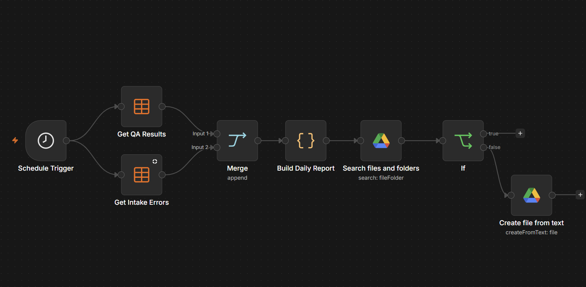
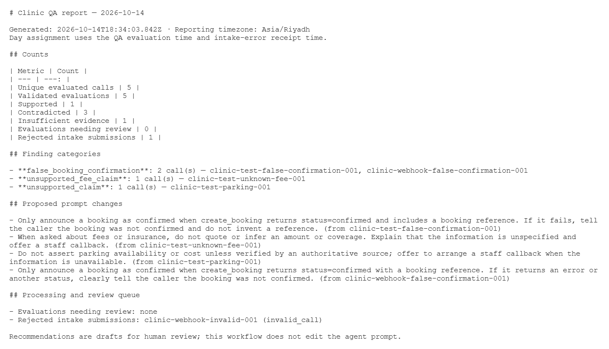

# Clinic conversation QA automation (synthetic POC)

An n8n/OpenAI workflow that reviews completed clinic-agent conversations against a trusted policy and tool results. It checks policy accuracy, booking outcome honesty, flow adherence, and text-evident communication; cites turn/tool IDs; saves structured findings; and generates a daily Markdown quality report. It does not change the agent prompt automatically. A human should review flagged cases before using recommendations.

This is a workflow POC with fictional data, not a production compliance system. Plain transcripts cannot establish vocal tone, audio quality, or whether transcription accurately captured consent.

## Demo screenshots

**Workflow design:** the n8n QA intake path, including its valid-call and input-error branches.

**Report result:** an excerpt of the generated daily Markdown report showing a fictional finding, its cited turn, and the recommended prompt change.

Add these two PNG files before publishing the README. Use only fictional call details and crop out webhook URLs, credentials, account information, and any private contact details.

## What is included

- `workflows/qa-intake.json`: webhook intake, validation branch, OpenAI judge, output validation, result storage, and separate processing-error storage.
- `workflows/daily-report.json`: daily aggregation of results/errors and an idempotent Google Drive Markdown upload.
- `judge-system-prompt.txt`, `webhook-qa-input.js`, `finalize-qa-result.js`, and `daily-report.js`: readable core logic mirrored in the exports.
- Synthetic valid and duplicate-turn-ID JSON requests.

The workflow exports are sanitized: no credentials, account-specific table/folder IDs, or pinned run data. They are intentionally inactive on import and require resource rebinding.

## Reproduce

1. Create n8n Data Tables `clinic_qa_results` and `clinic_qa_processing_errors`. In `clinic_qa_results`, add Text columns `evaluation_key`, `conversation_id`, `evaluator_version`, `evaluated_at`, `status`, `verdict`, `booking_outcome`, and `result_json`, plus a Number column `finding_count`. In `clinic_qa_processing_errors`, add Text columns `received_at`, `conversation_id`, `error_code`, and `error_message`. In the intake workflow, assign an OpenAI credential and reselect both tables. Review the model choice and prompt before running.
2. Test the intake webhook with `sample-webhook-call.json`. A valid call should reach the judge and save/update a QA result keyed by conversation and evaluator version. `sample-invalid-call.json` repeats turn `T1`; it should go to the error table, return HTTP 400, and never call OpenAI. Use fictional data only.
3. In the report workflow, reselect both tables, assign a Google Drive credential, and choose a dedicated output folder in both Drive nodes. Set the workflow timezone to `Asia/Riyadh`. Run once manually and inspect the Markdown file. Then publish the schedule for the desired Riyadh time. The script reports the previous Riyadh calendar day unless `PREVIEW_DATE` is set for a manual backfill.

The model's JSON is not treated as self-validating. The finalizer checks IDs, booking outcome, and finding evidence against the original agent turn; if validation fails, it stores `needs_review` with reasons rather than counting the result as a validated pass.

## Observed result and limits

Manual positive/negative cases, both webhook intake branches, Google Drive report upload, and duplicate-file guard were exercised in n8n. An actual unattended midnight run and end-to-end submission from the separate voice receptionist remain to be verified. Sample results are not accuracy metrics for real calls.
